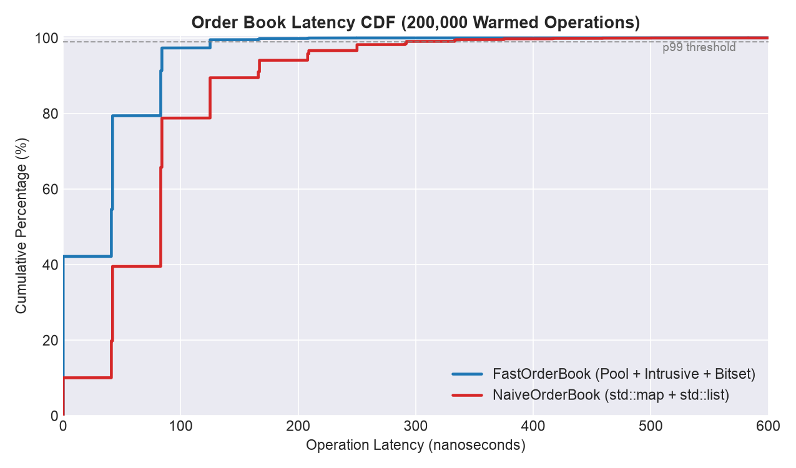
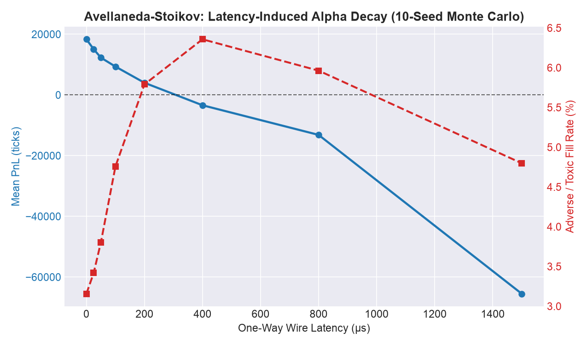
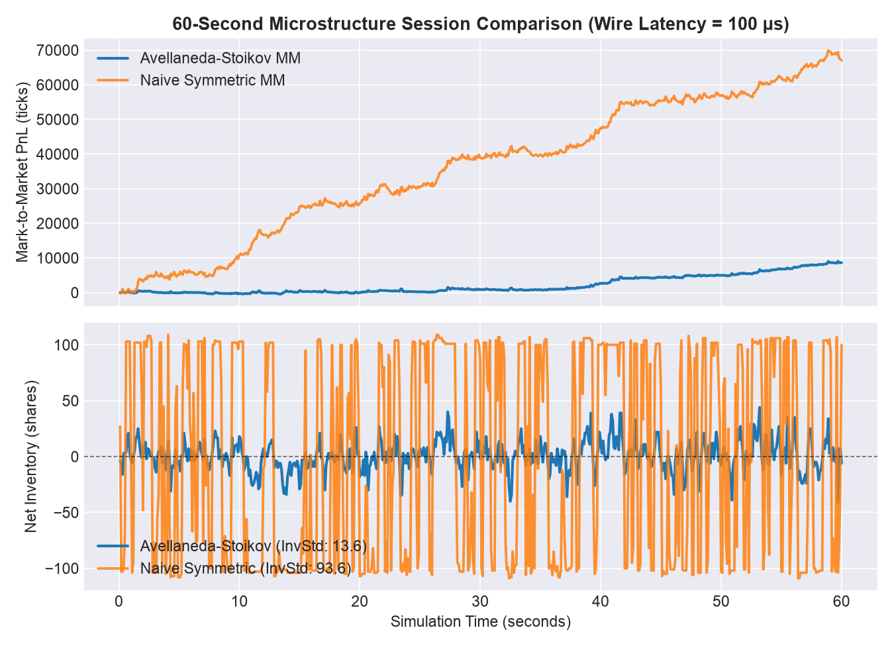

# QuantLOBSim: Low-Latency C++20 Limit Order Book & Market Microstructure Simulator

A high-performance, zero-allocation C++20 Limit Order Book (LOB) matching engine paired with an event-driven market microstructure simulator to study latency-induced adverse selection and Avellaneda-Stoikov market making.

## Architecture
- **Dual-Engine Design:** Compares a baseline `NaiveOrderBook` (`std::map` + `std::list`) against a cache-friendly `FastOrderBook` featuring:
  - Pre-allocated contiguous `MemoryPool` with 32-bit index links (zero heap allocations on the hot path).
  - Intrusive doubly linked lists for $O(1)$ FIFO queue management and cancellation.
  - Flat price array with a C++20 hardware bitset (`std::countr_zero` / `std::countl_zero`) for $O(1)$ best-bid/ask discovery.
  - Tombstone-free open-addressing `FlatHashMap` with backward-shift deletion.
- **Verification:** 25 GoogleTest unit & typed tests plus a **200,000-event differential fuzzer** verifying 100% identical fills, top-of-book prices, and volumes between `FastOrderBook` and `NaiveOrderBook`.
- **Microstructure Simulator:** Discrete-event nanosecond scheduler modeling Poisson liquidity providers, uninformed retail flow, fundamental price jumps, informed snipers, and configurable wire latency ($\delta$).

## Matching Engine Benchmarks (Apple Silicon, Release `-O3 -mcpu=native`)
Evaluated on **1,000,000 realistic market events** (306,519 verified identical trades):

| Engine | Throughput | Mean Latency | p50 | p99 | p99.9 |
| :--- | :---: | :---: | :---: | :---: | :---: |
| `NaiveOrderBook` (`std::map` + `std::list`) | 11.14 M ops/s | 89.75 ns | 83 ns | 292 ns | 458 ns |
| **`FastOrderBook` (Pool + Intrusive + Bitset)** | **41.20 M ops/s** | **24.27 ns** | **41 ns*** | **125 ns** | **208 ns** |
| **Speedup** | **3.70x** | **3.70x** | **2.02x** | **2.34x** | **2.20x** |

*\*Apple Silicon's `CNTVCT_EL0` hardware counter ticks at 24 MHz (41.67 ns resolution), so sub-tick operations quantize to 41 ns buckets.*



## Market Making & Latency Adverse Selection Results
10-seed Monte Carlo sweep across wire latencies (`0 µs` to `1,500 µs`):
- **Inventory Risk Control (100 µs):** `AvellanedaStoikovMM` reduces inventory standard deviation by **6.9x** (`13.57` vs `93.61`) and Max Drawdown by **3.3x** (`940` vs `3,131` ticks) relative to `NaiveSymmetricMM`.
- **Latency Alpha Decay:** Increasing one-way wire latency from `0 µs` to `400 µs` doubles toxic sniper fills (`3.16%` → `6.36%`) and degrades `AvellanedaStoikovMM` Sharpe from **`+4.96`** to **`+0.27`** (`-2.39` at `1,500 µs`).




## Build & Run
```bash
cmake -B build -DCMAKE_BUILD_TYPE=Release
cmake --build build -j
ctest --test-dir build --output-on-failure
./build/lob_bench
./build/lob_sim
python3 analysis/plot_results.py